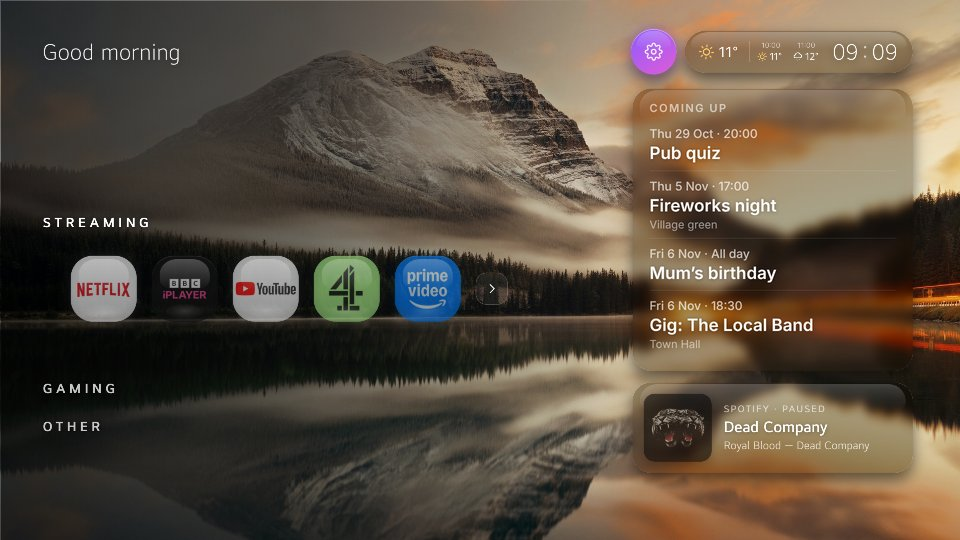

# web-OSome

A lovely AI slop home screen for my LG TV that isn't full of crap I don't want.



LG's own home screen is bloated, ad filled and hard to navigate, so
I made my own. It's a plain web app (HTML, CSS and ES5 JavaScript, no build step, no npm)
that runs as a normal webOS app. It shows the apps I actually use in a few rows, and plays nice with Home Assistant too, so one button can turn the console and amp on and
switch to the right HDMI input.

Built for my LG OLED55A2 (webOS 23). It'll probably work on other webOS TVs but I
haven't tried. On the TV it shows up as **TV Home** (its old name).

## What it does

- Rows of app tiles (Streaming, Gaming, Other). Arrow keys and the Magic Remote pointer both work.
- A tile can open an app or HDMI input, call a Home Assistant webhook, or both.
- Clock, weather, calendar, bin day and "now playing" (Yamaha MusicCast) tiles. They're all plugins, so delete the folder if you don't want one.
- Opens when the TV turns on, and is kept loaded in standby so switching on is quick (rooted TVs).
- Dims when idle and nudges the screen a pixel or two now and then, to be kind to the OLED.
- **Rooted TVs only:** edit everything from your phone (scan a QR code on the TV), use the TV's real app icons, and take over the Home button.

## Before you start: root the TV (optional, but worth it)

The basics work on a normal TV in Developer Mode, but the good bits (phone editor, real
app icons, taking over the Home button, no Developer Mode timer) need a rooted TV with
the Homebrew Channel installed. webOS Brew's [rooting guide](https://www.webosbrew.org/rooting/)
tells you which method works for your TV and firmware, so follow that rather than me.

## Put it on the TV

### Either

You need the TV in Developer Mode and LG's `ares` tools
([webOS Brew's guide](https://www.webosbrew.org/devmode/) explains it better than I can).
Then, from the folder above this one:

```
ares-package web-osome
ares-install --device tv net.local.tvhome_1.0.0_all.ipk
ares-launch  --device tv net.local.tvhome
```

For a leaner install without the diagnostics, run `web-osome/tools/lean/build.sh` instead of `ares-package` (more in [the guide](docs/GUIDE.md#3-install-on-the-tv)).
Ready-made `.ipk` files (normal and lean) are on the [Releases](https://github.com/geekyboi/web-OSome/releases) page.

### Or install from the Homebrew Channel (rooted TVs)

No computer or `ares` tools needed, and the TV gets updates from there too.

1. In the Homebrew Channel, open **Settings → Add repository** and enter
   `https://geekyboi.github.io/web-OSome/apps.json` (the lean build).
   For the build with the `tools/perf` diagnostics, use
   `https://geekyboi.github.io/web-OSome/full/apps.json` instead.
2. Back in the app list, pick **TV Home** and press **Install** (later, **Update**).
3. Once, in a root shell on the TV ([webOS Dev Manager](https://github.com/webosbrew/dev-manager-desktop) → Terminal), run:
   ```
   sh /media/developer/apps/usr/palm/applications/net.local.tvhome/startup/install.sh
   ```

Still set up by hand, as before: the Home Assistant automation, the Home button
(LG Input Hook, see [the guide](docs/GUIDE.md#5-the-home-button-needs-root)) and the
`tools/perf` logger.

Heads up: Developer Mode has a time limit, and the TV removes the app when it runs out. If
your TV isn't rooted, renew it in the Developer Mode app.

## Set it up

- **Your apps:** edit `js/config.js`. It's commented. (Or use Settings on the TV: press the red button.)
- **Open at power-on:** without root, use the Home Assistant automation in
  `home-assistant/automations.yaml`. With root, run `startup/install.sh` once on the TV.
- **Phone editor (root):** run `startup/install.sh`, then on the TV go to Settings → Phone & laptop and scan the QR code.

Passwords, your Home Assistant token, calendar links and so on are entered in the phone
editor and saved **on the TV**, so none of it ends up in this repo.

There's a lot more detail (the Home button, calendars, bins, backgrounds, measuring RAM
and CPU...) in [docs/GUIDE.md](docs/GUIDE.md).

## Plugins

Every tile around the dock (clock, weather, calendar, bins, now playing, greeting) is a
folder in `plugins/`. Delete a folder to remove its tile; put it back to bring it back
(its settings are kept). The app picks up changes within 30 seconds, no rebuild needed.

To try the example, copy `example-plugins/hello` into `plugins/`. A "Hello, world!" card
appears in the right-hand column.

On the TV the folder is `/media/developer/apps/usr/palm/applications/net.local.tvhome/plugins/`.
How to write your own: [plugins/README.md](plugins/README.md).

## Finding your way around

[docs/ARCHITECTURE.md](docs/ARCHITECTURE.md) has a diagram of how it fits together, and
[AGENTS.md](AGENTS.md) has the file map and the rules (written for AI assistants, but it's
the best short tour for people too).

## Thanks

App IDs and the Homebrew Channel tricks for the app list come from
[webos-launcher](https://github.com/partridgeworks/webos-launcher) (MIT), and the icon
trick from [Hearth](https://github.com/rudra-avatar/Hearth). The phone editor borrows code
from [a gist by Informatic](https://gist.github.com/Informatic/319bcaf94436b9136904473ca4f4ec9c).

## Licence

MIT, see [LICENSE](LICENSE).

---

It works on my telly, which is the main thing. Issues and PRs are welcome, but I'll get to
them when I get to them.
