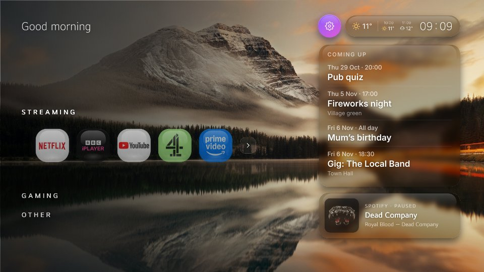

# web-OSome

A home screen for my LG TV that isn't full of adverts.



LG's own home screen got slow and kept pushing "recommended" stuff I never asked for, so
I made my own. It's a plain web app (HTML, CSS and ES5 JavaScript, no build step, no npm)
that runs as a normal webOS app. It shows the apps I actually use in a few rows, and a
tile can poke Home Assistant too, so one button can turn the console and amp on and
switch to the right HDMI input.

Built for my LG OLED55A2 (webOS 23). It'll probably work on other webOS TVs but I
haven't tried. On the TV it shows up as **TV Home** (its old name).

## What it does

- Rows of app tiles (Streaming, Gaming, Other). Arrow keys and the Magic Remote pointer both work.
- A tile can open an app or HDMI input, call a Home Assistant webhook, or both.
- Clock, weather, calendar, bin day and "now playing" (Yamaha MusicCast) tiles. They're all plugins, so delete the folder if you don't want one.
- Opens when the TV turns on.
- Dims when idle and nudges the screen a pixel or two now and then, to be kind to the OLED.
- **Rooted TVs only:** edit everything from your phone (scan a QR code on the TV), use the TV's real app icons, and take over the Home button.

## Try it on your computer

```
python3 -m http.server 8000
```

Open http://localhost:8000. Arrow keys, Enter and the mouse work. Tiles say what they
*would* launch instead of launching.

## Put it on the TV

You need the TV in Developer Mode and LG's `ares` tools
([webOS Brew's guide](https://www.webosbrew.org/devmode/) explains it better than I can).
Then, from the folder above this one:

```
ares-package web-osome
ares-install --device tv net.local.tvhome_1.0.0_all.ipk
ares-launch  --device tv net.local.tvhome
```

Heads up: Developer Mode runs out, and the TV removes the app when it does. Renew it
in the Developer Mode app.

## Set it up

- **Your apps:** edit `js/config.js`. It's commented. (Or use Settings on the TV: press the red button.)
- **Open at power-on:** without root, use the Home Assistant automation in
  `home-assistant/automations.yaml`. With root, run `startup/install.sh` once on the TV.
- **Phone editor (root):** run `startup/install.sh`, then on the TV go to Settings → Phone & laptop and scan the QR code.

Passwords, your Home Assistant token, calendar links and so on are entered in the phone
editor and saved **on the TV**, so none of it ends up in this repo.

There's a lot more detail (the Home button, calendars, bins, backgrounds...) in
[docs/GUIDE.md](docs/GUIDE.md).

## Finding your way around

| Where | What |
|---|---|
| `index.html` | The page. Lists the scripts in the order they load. |
| `js/config.js` | Your apps and defaults. Start here. |
| `js/core/` | The launcher itself, one job per file: `dock.js` (the rows of tiles), `actions.js` (launching and webhooks), `plugins.js`, `glass.js` (background and frosted panels), `main.js` (start-up and the remote)... |
| `js/settings.js`, `js/settings-sources.js` | The Settings screen on the TV, and where it finds apps to add. |
| `plugins/` | The tiles around the dock. How to write one: [plugins/README.md](plugins/README.md). There's a tiny example in `example-plugins/hello`. |
| `service/` | A small Node service that runs on the TV (rooted only): stores the layout and serves the phone editor. `service.js` starts it, `lib/` does the work. |
| `service/web/` | The phone editor (`editor/` has one file per part of it). |
| `startup/` | Scripts to open the app at power-on (rooted TVs). |
| `home-assistant/` | Example automations and an extra-apps list for Home Assistant. |

The browser files are plain scripts that share one scope, so a function in one file can
call one in another as long as both are loaded (see the order in `index.html`). Every
function has a one-line comment saying what it does.

## Thanks

App IDs and the Homebrew Channel tricks for the app list come from
[webos-launcher](https://github.com/partridgeworks/webos-launcher) (MIT), and the icon
trick from [Hearth](https://github.com/rudra-avatar/Hearth).

## Licence

MIT, see [LICENSE](LICENSE).

---

It works on my telly, which is the main thing. Issues and PRs are welcome, but I'll get to
them when I get to them.
