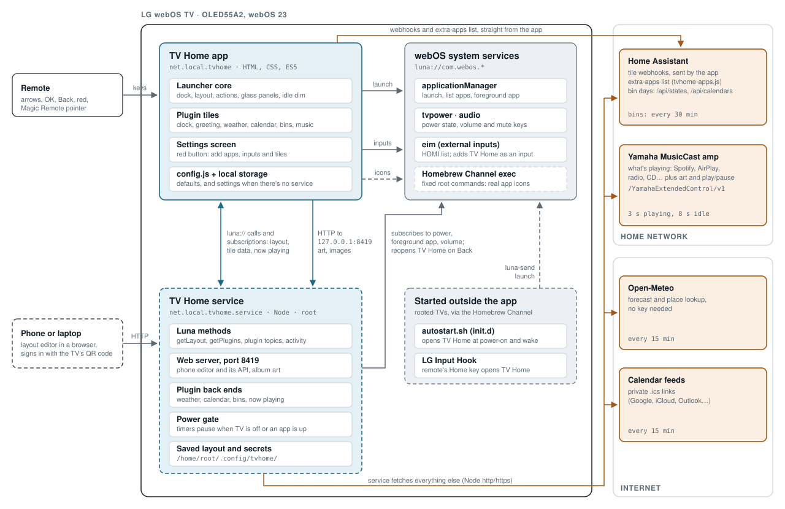

# How TV Home fits together

A web app on the TV draws the home screen. On a rooted TV a small Node service sits
behind it, keeps the layout and does all the network fetching, so the screen only ever
shows what the service publishes. Everything talks to the TV through webOS Luna services.

Blue is TV Home's own code, grey is part of the TV, orange is outside the TV.
Dashed boxes and lines only exist on a rooted TV. The service polls everything outside
and pushes results to the screen over Luna subscriptions; its timers stop while the TV
is off or another app is in front. Only tile webhooks and the extra-apps list go straight
from the app to Home Assistant.

## Things worth knowing

- **Spotify comes through the amp.** There's no Spotify account, key or call. The
  now-playing tile asks the MusicCast amp what it's playing; Spotify Connect is one of the
  sources it reports. Play and pause go to the amp too.
- **Apps are launches, not plugins.** YouTube, Netflix and so on are dock tiles that call
  `applicationManager/launch`. The volume subscription is the TV's own volume and mute
  keys, used only to wake the dimmed screen.
- **Without root it still works.** No service means no phone editor, real icons, autostart
  or Home button. The app uses `js/config.js` and local storage; launching and webhooks
  still work, but data tiles stay empty.
- **Which settings win:** `js/config.js` < local storage < the service's copy in
  `/home/root/.config/tvhome/`. Secrets live only there.

## Every interface

| Interface | Who calls it | When | Root |
|---|---|---|---|
| `applicationManager/launch` | App, service (Back to LG home), `autostart.sh`, Input Hook | On demand | App: no |
| `applicationManager/listLaunchPoints`, `getAppLoadStatus` | App Settings, service editor API | Adding apps | No |
| `eim/getAllInputStatus`, `addDevice` | App | Start-up, Settings | No |
| `applicationManager/getForegroundAppInfo` | Service | Subscribed | Yes |
| `tvpower/power/getPowerState` | Service, `autostart.sh` | Subscribed | Yes |
| `audio/master/getVolume` | Service | Subscribed | Yes |
| `org.webosbrew.hbchannel.service/exec` | App (fixed commands only) | Fetching icons, 8 at a time | Yes |
| `net.local.tvhome.service/*` | App | Subscribed | Yes |
| HTTP on port 8419 | Phone editor, app (art, images) | On demand | Yes |
| Home Assistant `/api/webhook/…` | App | OK on a webhook tile | No |
| Home Assistant `/local/tvhome-apps.js` | App Settings | Opening that tab | No |
| Home Assistant `/api/states`, `/api/calendars` | Service, bins plugin | Every 30 min | Yes |
| MusicCast `/YamahaExtendedControl/v1` | Service, now-playing plugin | 3 s playing, 8 s idle, only while home is showing | Yes |
| Open-Meteo forecast and geocoding | Service, weather plugin | Every 15 min | Yes |
| Calendar `.ics` links | Service, calendar plugin | Fetch every 15 min, refresh every 5 | Yes |
